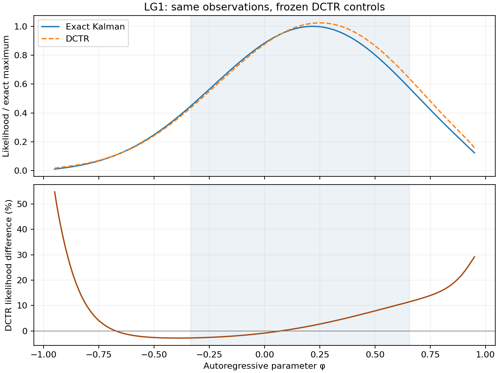

# LG1 likelihood size and MLE agreement — 2026-09-22

Pilot closeout after the owner's subsequent review of acceptance and R-hat:
LG1 is satisfactory at the accepted practical accuracy. The B arm records
73.33% mean acceptance, maximum rank/folded R-hat 1.00148, no divergences,
and no detected posterior discrepancy in the exact-reference comparisons.
Together with the likelihood/MLE checks below, this supports ending the LG1
pilot investigation and proceeding to other models. No further LG1 likelihood
repair or retained-chain extension is planned. This is a practical campaign
decision; the original formal equivalence outcomes remain unchanged. Healthy
acceptance and R-hat alone are not a proof of posterior correctness, and no
computational advantage is established by this closeout.

Owner assessment after reviewing the parameter estimates: "in this case, it
looks perfectly fine to me." Record the observed LG1 MLE difference as
acceptable for this case: 0.03340 in phi, or 0.090 posterior standard
deviations, with 0.2793% exact-likelihood loss at the DCTR MLE. Further reduction
of this discrepancy is not a prerequisite for proceeding with the surrogate-HMC
test. This is a practical assessment of the observed approximation; the
archived D/R margin result and inconclusive sampler comparisons remain as
measured. No tolerance, runtime default or result classification is changed.

The LG1 surrogate-force experiment has not demonstrated a sampler failure.
Its existing B/R result is inconclusive: all six intervals contain zero, but
three CDF intervals are too wide to establish the chosen equivalence margins.
The exact-force comparator is also inconclusive. Separately, the finite DCTR
likelihood has a small, measurable posterior tilt. Its maximum is close to
the Kalman maximum, and the exact likelihood at DCTR's maximizing parameter
is only **0.2793% below the exact maximum**. This supports the owner's judgment
that the MLE error is modest. It does not establish equality of the posterior
curves, and that equality is not required of the force in B/R.

The full numerical comparison is in
[report.json](artifacts/surrogate-hmc-all-models-20260922-lg1-likelihood-02/report.json),
[curve CSV](artifacts/surrogate-hmc-all-models-20260922-lg1-likelihood-02/likelihood-curve.csv),
and the [run manifest](artifacts/surrogate-hmc-all-models-20260922-lg1-likelihood-02/run-manifest.json).
The [prospective plan](surrogate-hmc-lg1-likelihood-diagnostic-2026-09-22.md)
defines the diagnostic scope and budget.

The percentage denominator matters. For log likelihoods ell_D and ell_K,
the likelihood difference in percent is **100[exp(ell_D - ell_K) - 1]**.
Dividing by the magnitude of a negative log likelihood is a different
quantity, sensitive to additive normalization constants; it is not a
likelihood percentage. At the exact grid MLE the two calculations give
2.1135% and 0.09527%, respectively. All Gaussian normalization constants are
included, and the FP32 uniform-prior constant was removed exactly once from
the stored physical log posterior before this comparison.

| Location | phi | Exact log likelihood | DCTR log likelihood | DCTR likelihood difference |
|---|---:|---:|---:|---:|
| Exact grid MLE | 0.217090 | -21.952992 | -21.932077 | +2.1135% |
| DCTR grid MLE | 0.250488 | -21.955789 | -21.929162 | +2.6984% |
| Nearest grid point to exact posterior 10% quantile | -0.333984 | -22.755706 | -22.783840 | -2.7742% |
| Nearest grid point to exact posterior 90% quantile | 0.656836 | -22.513261 | -22.404598 | +11.4787% |

These are maxima over 1,025 saved points, with spacing 0.00185547, not
continuous optimizations. The MLE shift is 0.0333984, or 0.08959 of the exact
posterior standard deviation. Comparing the two maxima gives a +2.4116%
likelihood difference. The likelihood error ranges from -2.77% to +11.43%
on grid points inside the exact central 80% posterior interval. Across the
entire bounded support it ranges from -2.82% to +54.73%; the largest relative
error occurs near the low-likelihood negative boundary. Weighted by the exact
posterior, mean absolute relative likelihood error is 4.7724%. These quantities
describe this fixed dataset and particle design, not variation across datasets.

The blue band is the exact central 80% posterior interval. Both curves in the
top panel are divided by the same exact likelihood maximum, preserving their
relative levels. Integrating over the shared support gives a +3.4102%
unnormalized likelihood integral difference. This normalization removes much
of the level difference from the posterior, but it cannot remove the tilt.
The finite posterior puts 47.8883% of its mass below the exact posterior
median, where the exact posterior puts 50%. That is the earlier **-2.1117
percentage-point** CDF discrepancy. On the finest grid, the maximum absolute
CDF difference is about 2.2036 points and total variation is about 2.2855%.
These integration diagnostics use the archived refinement evidence, not a
rigorous global error bound. The old 2-point tolerance is a chosen accuracy
requirement; its exceedance is not a mathematical instability or an automatic
reason to reject surrogate HMC.

MLE agreement alone is insufficient because it says where a curve peaks,
not how it distributes mass. More strongly, even exact MLE agreement would
not establish equal posterior variances. Conversely, if DCTR differed from
Kalman by a constant log-likelihood offset, the normalized posteriors would
be identical. The measured error is parameter-dependent, so neither argument
eliminates the observed CDF difference. How consequential 2.1 points is depends
on the downstream accuracy requirement; it should not have been presented as
an unexplained failure of a simple model.

For the actual surrogate-HMC question, the existing B chain used DCTR only
for its force and the exact Kalman value for acceptance. Its CDF at the exact
median is 48.95%, a -1.05-point observed difference, with the frozen interval
[-3.5805, +1.4805] points for that difference. The interval contains zero and
extends beyond the -2-point margin: insufficient precision for equivalence,
not evidence of a discrepant sampler. DCTR likelihood approximation error
does not substitute for this test. The finite-endpoint C/D and D/R results
answer different questions.

Fresh verification completed in 19.295 seconds on the RTX 4080 SUPER using
TensorFlow, TF32, XLA and verified memory growth. At the four points in the
table, two fresh canonical DCTR evaluations exactly match the archived values;
all force and endpoint status checks pass. The independent dense Gaussian
observation likelihood and fresh Kalman curve agree within 2.14e-14 log units
over the full grid. Both consume exactly the FP32 data promoted to FP64.
No new retained HMC chain was run, and old equivalence verdicts are preserved.

The first attempt stopped at source validation before numerical evaluation:
the selection issuer acquired model/attempt validation after the artifact was
issued. All 17 numerical source hashes matched. The one retry loaded the
hash-matching archived issuer in an isolated diagnostic module and retained
its original scope, source and evidence checks. Neither the master program
nor current selection authority was changed. The failed attempt is preserved
in the sibling `lg1-likelihood-01/failure.json`; its resource usage was not
metered, so 60 CPU and 60 GPU seconds are charged conservatively. The successful
run used 21.262740 process CPU seconds and 19.294813 GPU-wall seconds.
Earlier unmetered CPU-only calculations have a conservative 120-second charge.

| Decision | Primary criterion status | Veto diagnostic status | Main uncertainty | Next justified action | Not concluded |
|---|---|---|---|---|---|
| B/R remains viable and inconclusive | Old equivalence test unchanged | No new sampler evidence; old numerical screens passed | Posterior Monte Carlo precision and uncertainty calibration | Qualify the uncertainty procedure and specify adequate precision before a fresh chain | Surrogate HMC fails, or posterior recovery established |
| Likelihood/MLE discrepancy quantified | Descriptive comparison completed | Hashes, data, endpoint, statuses, dense Gaussian check and fresh replay pass | Grid resolution; single dataset and particle bank | Use full likelihood shape to assess application relevance | MLE agreement proves posterior equality |
| D/R discrepancy preserved | Median-CDF difference exceeds old 0.02 requirement | No numerical validity veto | Empirical quadrature bound; practical relevance of chosen tolerance | Keep finite-target accuracy separate from force-only HMC | Research direction rejected |

| Inference status | Finding |
|---|---|
| Hard veto screen | First source replay rejected; isolated archived-validator replay passes all declared diagnostic checks |
| Statistically supported ranking | None; no new stochastic comparison |
| Descriptive-only differences | Likelihood ratios, MLE locations, posterior distance on this fixed dataset |
| Default readiness | Not established or changed |
| Next evidence needed | Calibrated prospective posterior-equivalence test; additional data/design replication for general accuracy |

Post-run red team: the strongest alternative to a practically consequential
likelihood error is an accuracy requirement tighter than the intended use
requires. MLE proximity alone cannot settle that judgment. Conversely, the
11.5% upper-quantile likelihood error prevents describing the whole curve as
uniformly accurate to 2%. The weakest evidence for generalization is the single
data realization and frozen particle bank. No claim of computational advantage
over exact Kalman inference is made.
